# kvxputerzero UI audit

Keyboard-only Cardputer Zero UI (320×170). Affordance rule: **only selectable things should look selectable** (accent border / pill rows). Prose manuals and static status must not look like menus.

**Method:** Drove `./scripts/ui_sweep.sh` with scripts under `app/scripts/ui_audit/`. Screenshots in `app/screenshot/audit/`. Each PNG was inspected with the image Read tool. Binary audited: `build/linux-x86-64/Debug/kvxputerzero` (built ~19:52). Concurrent source work added `DocScreen` / `InfoScreen` after that binary; a rebuild at audit time failed on a `DocScreen` font constness error — findings below (after the re-verification section) reflect **what the runnable emulator showed before migration**, with source notes for the then in-flight work. See **Re-verification** for post-migration status.

## Re-verification (after migration)

Re-ran `./scripts/ui_sweep.sh` against `build/linux-x86-64/Debug/kvxputerzero` (post Doc/Info/RunScreen/theme migration). Before shots remain under `app/screenshot/audit/`; after shots under `app/screenshot/audit/after/`. Original findings below are preserved as the audited-before baseline.

**Top-10 counts: Fixed 10 · Partial 0 · Still open 0** (residuals pass after RunScreen/calendar follow-up)

| # | Top-10 item | Status | Before → After |
|---|-------------|--------|----------------|
| 1 | Manuals → DocScreen (PC Connect howto/needs; MQTT/WG help) | **Fixed** | Before: per-line pills + green focus (`pcconnect_howto.png`). After: single Doc panel + wrap + `v` scroll (`after_pcconnect_howto.png`, `after_pcconnect_needs.png`). Also `after_mqtt_help.png`, `after_wireguard_help_attempt.png` as Doc. |
| 2 | Cap status → InfoScreen | **Fixed** | Before: RunScreen “Cap not present” pill (`rf_status.png`). After: `missing` chip + KV (`after_rf_status.png`, `after_nrf24_status.png`, `after_lora_status.png`). |
| 3 | RunScreen log chrome | **Fixed** | Follow-up: left-rule cursor (no full gray bar), slot **6** empty (`residual_rf_listen.png`). Enter still pins/freezes. |
| 4 | UseStock USB → Document | **Fixed** | Before: truncated menu entry + Back (`usb_usestock.png`). After: Doc body full sentence (`after_usb_usestock.png`). |
| 5 | Hints `make_info` → Doc | **Fixed** | Before: selectable one-liners (`ssh_hint.png`, `nrf24_info.png`). After: Doc panels (`after_ssh_hint.png`, `after_nrf24_info.png`, `after_fm_info.png`, `after_ibutton.png`). |
| 6 | Cap Probe / Unit Scroll / Bus / AP info | **Fixed** | Before: ResultList/RunScreen pills. After: Info cards (`after_cap_probe.png`, `after_unit_scroll.png`, `after_bus_scan.png`, `after_wifi_ap_info.png`). Residual QoL: long values / docs path still clip. Eth link also Info (`after_eth_link.png`). |
| 7 | MQTT status out of OptionsList | **Fixed** | Before: focusable `Status: disconnected` row (`mqtt_menu_or_help.png`). After: header status (`MQTT [ ] off`), Help first real action (`after_mqtt_menu.png`). |
| 8 | IR / BLE disconnect empty states | **Fixed** | Before: fake menu rows. After: Info cards (`after_ir_use.png` missing+KV; `after_ble_disconnect.png` OK chip + result). |
| 9 | Clock / Charge calendar cell clip | **Fixed** | Follow-up: cell height from font line-height, fewer rows if needed (`after_cal2_charge.png`). |
| 10 | Light theme | **Fixed** | Before: pinned dark / no-op. After: `theme light` flips bg (`after_home_light.png`, `after_pcconnect_howto_light.png`, `after_rf_status_light.png` — status ~218/204 vs dark ~26/44). |

### New / residual notes (this pass)

- Soft leftover: Doc scroll can still clip first/last lines at the panel edge (`residual_doc_scrolled.png`).
- Soft leftover: dense Info cards can collide with the footer (`after_cap_probe.png`, `after_wifi_ap_info.png` prefix).
- Unit Scroll KV values shortened; fixed-height DOT rows (`residual_unit_scroll.png`).
- Device spot-check (cp0 @ 192.168.50.153) not run from this session — do PC Connect / RF Cap / Cap Probe / RF Listen on-device when convenient.
- Home page-3 sparse 2×2 unchanged (pre-existing low).
- Fn+H help inject still unverified as working under scripts.

## Summary *(audited-before baseline — do not treat as current)*

- **Systemic:** Almost every non-menu surface reuses `ResultListScreen` / `RunScreen` list rows (`view::make_list_row` + `apply_row_state`). Prose lines, status strings, and live log lines all get the same pill + green focus border as real menus.
- **`make_info` → `make_results`:** One-line and multi-line hints become selectable rows (SSH, iButton, FM/NRF24 info, USB placeholder text).
- **`make_run` logs:** Cap-missing and live tools paint log lines as menu pills; focus lands on the last/only line (“Cap not present”).
- **Hand-wrapped manuals:** PC Connect howto/needs ship pre-broken lines as rows (empty spacer rows included).
- **Theme:** `BaseModel::set_dark_mode` pins `dark_mode_ = true` — `theme light` is a no-op; light samples match dark.
- **Menus are fine:** Channel tool lists, home grid, WireGuard actions, GPS Live choices correctly use pill focus.
- **Migration in source (not in audited binary):** `make_info` → `DocScreen`; cap status / AP info / Unit Scroll / Cap Probe → `InfoScreen` + `make_kv_row`. Many `make_results(...)` call sites remain (~17 in `tool_screens.cpp`).

## Content-type taxonomy

| Type | When to use | Visual language |
|------|-------------|-----------------|
| **Menu** | User picks an action or target | Pill rows; accent border on focus; Enter activates |
| **Document** | Manuals, howtos, multi-paragraph help | Wrapped body in a panel; **no** per-line borders/focus; Up/Down scroll only |
| **Info card** | Key/value status, hardware presence | Status chip (not focusable menu chrome) + non-selectable KV rows |
| **Live log** | Streaming scan/listen/export output | Monospace/plain lines; optional caret on “follow”; **no** menu selection border |
| **Prompt** | Typed input | Input field + confirm; not a fake list |

## Findings by channel

### home

#### Grid (dark)
- Screenshot: 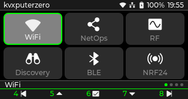
- Current type: Menu (channel tiles) — **correct**
- QoL:
  - [low] Page 3 is a 2×2 on the left with empty right half (`home_page3_charge.png`)
  - [med] `theme light` does not change appearance (`home_light.png` / `home_light_attempt.png`); source: `BaseModel::set_dark_mode` pins dark — **[status: Fixed]** after: `after/after_home_light.png`

#### Fn+H help
- Screenshot:  (identical to home — overlay did not appear under `key help` / `fn+h` in scripts)
- Current type: expected HelpPopup (`help_popup.cpp`)
- QoL:
  - [med] Scripted help inject did not show “Keyboard help”; verify desktop key path vs `HelpPopup::show`
  - Fix: ensure `inject_named_key("help")` reaches the same branch as Fn+H in `app.cpp`

### pcconnect

#### Channel menu
- Screenshot:  *(nav capture flaky; menu is OptionsList — correct)*
- Current type: Menu — OK when How to use / What you need / Browse / Export are actions

#### How to use
- Screenshot: 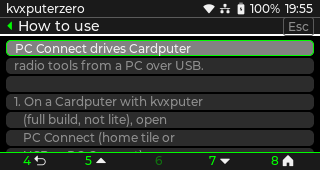 · light attempt  · scrolled 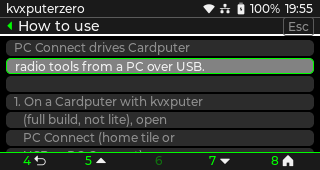
- Current type: ResultList (menu rows)
- Target type: Document
- Source: `make_pcconnect_howto` in `tool_screens.cpp` (audited binary used `make_results`; tree now routes `make_info` → `DocScreen`)
- QoL:
  - [high] Each prose fragment is a selectable bordered row; Enter does nothing useful — **[status: Fixed]** `after/after_pcconnect_howto.png`
  - [med] Hand-wrapped lines / empty spacer rows / bottom clip under action bar — **[status: Fixed]** (wrap-at-render); residual panel edge clip when scrolled
  - [med] Nav slots 5/7 imply “choose a row” rather than scroll document — **[status: Partial]** Up/Down now scroll Doc; Check slot empty
  - Fix: `DocScreen` with wrapped body + `#` / `-` / `` ` `` markup (already sketched in `doc_screen.cpp`)

#### What you need
- Screenshot: 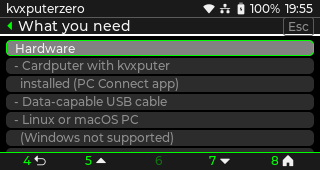
- Current type: ResultList
- Target type: Document
- Source: `make_pcconnect_needs`
- QoL:
  - [high] Section headers (“Hardware”) look like selectable items — **[status: Fixed]** `after/after_pcconnect_needs.png`
  - [med] Bullet fragments split across rows — **[status: Fixed]**
  - Fix: same DocScreen body as howto

#### Browse scripts
- Screenshot: 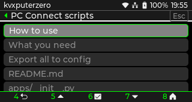
- Current type: Menu — **correct** for actions/files
- QoL:
  - [low] Last row clipped by footer
  - [med] Opening a script file still uses `make_results` (file view as menu rows) — target Document

#### Export
- Screenshot: 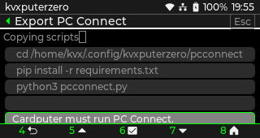
- Current type: Live log via RunScreen (menu-row chrome)
- Target type: Live log (plain) or Document summary when done
- Source: `make_pcconnect_export` → `make_run`
- QoL:
  - [high] Instructional / path lines are focusable pills; last line holds green border — **[status: Fixed]** left-rule cursor, empty Check (`residual_rf_listen.png` / export inherits)
  - [med] Long path clipped in row
  - Fix: RunScreen log lines without `make_list_row` selection chrome; or finish → DocScreen

### wifi

#### Channel menu
- Screenshot: 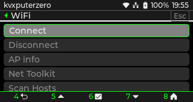
- Current type: Menu — OK

#### AP info
- Screenshot: 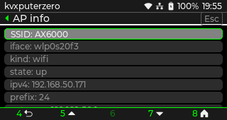
- Current type: ResultList (audited binary)
- Target type: Info card
- Source: `make_wifi_ap_info` (tree now `make_info_card` / InfoScreen)
- QoL:
  - [high] SSID/iface/IP fields look selectable — **[status: Fixed]** `after/after_wifi_ap_info.png`
  - [med] Bottom row clipped — **[status: Partial]** footer collision on dense cards; panel scrolls
  - Fix: ship InfoScreen KV rows (no accent border on fields)

### netops / ethernet / discovery

#### Ethernet menu
- Screenshot:  *(filename polluted by a later overwrite — treat as Clock face evidence below)*
- Link-status tool still uses `make_results` for lines (`tool_screens.cpp` ethlink) — target Info card — **[status: Fixed]** `after/after_eth_link.png` (Info card, `none` + link message)

#### Discovery index
- Screenshot: 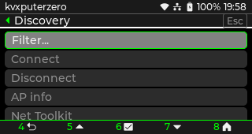
- Current type: Menu of tools — OK when entries are actions

### ble

#### Scan (live)
- Screenshot: 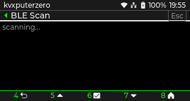
- Current type: RunScreen (empty “scanning…” — no rows yet)
- Target type: Live log
- QoL:
  - [med] When devices appear, same RunScreen will paint them as menu pills (see RF Listen / Cap Probe) — **[status: Fixed]** inherits left-rule log rows
  - [low] Empty wait state is fine; status line is non-selectable

#### Disconnect hint
- Screenshot: 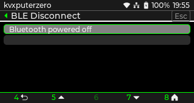
- Current type: ResultList
- Target type: Info card / Document
- Source: `make_results(..., "BLE Disconnect", ...)`
- QoL:
  - [high] “Bluetooth powered off” + empty row look like a menu — **[status: Fixed]** `after/after_ble_disconnect.png`
  - Fix: InfoScreen or DocScreen one-liner

### rf

#### Menu
- Screenshot: 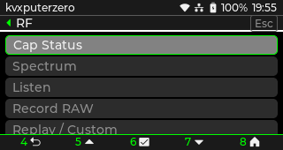
- Current type: Menu — OK

#### Cap Status
- Screenshot: 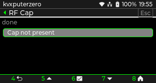 · light  (identical — theme pinned)
- Current type: RunScreen log as menu pill
- Target type: Info card
- Source: `make_rf_tool` / `RfStatus` (tree now `make_info_card`)
- QoL:
  - [high] “Cap not present” is a single selected pill; slots 5–7 imply choose/activate — **[status: Fixed]** `after/after_rf_status.png`
  - [low] Dim “done” status — N/A on InfoScreen
  - Fix: InfoScreen status chip Missing + KV (`chip`, `status`)

#### Listen / Spectrum (live / missing hw)
- Screenshots:  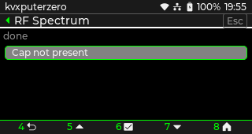
- Current type: RunScreen menu chrome
- Target type: Live log
- QoL:
  - [high] Error log line uses selectable border — **[status: Fixed]** `residual_rf_listen.png` (left rule; Check empty)
  - Fix: plain log rows; reserve pills for interactive picks only

### nrf24

#### Information
- Screenshot: 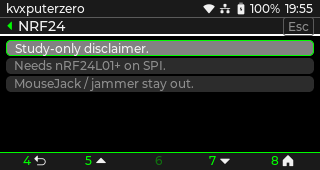
- Current type: ResultList / make_info
- Target type: Document
- Source: `cap_screens.cpp` NRF24 info → `make_info` (→ DocScreen in tree)
- QoL:
  - [high] Disclaimer lines are selectable pills — **[status: Fixed]** `after/after_nrf24_info.png`
  - Fix: DocScreen paragraph

#### Module Status / Listen
- Screenshots:  
- Current type: RunScreen pills
- Target type: Info card / Live log
- QoL:
  - [high] Same “Cap not present” menu affordance as RF — **[status: Fixed]** status → Info (`after/after_nrf24_status.png`); listen inherits Fixed RunScreen

### lora

#### Cap Status / Meshtastic
- Screenshots: 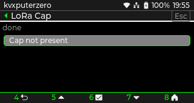 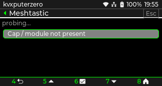
- Current type: RunScreen pills
- Target type: Info card
- QoL:
  - [high] “Cap not present” / “Cap / module not present” look selectable — **[status: Fixed]** `after/after_lora_status.png`
  - Fix: InfoScreen Missing chip

### fm

#### Information / Module Status
- Screenshots: 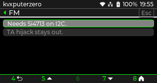 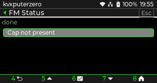
- Current type: ResultList / RunScreen
- Target type: Document / Info card
- Source: `FmInfo` → `make_info`; status → run/info card
- QoL:
  - [high] “Needs Si4713…” is a focused menu row — **[status: Fixed]** `after/after_fm_info.png`
  - [high] Status “Cap not present” pill — **[status: Fixed]** (same Info pattern as RF; not re-shot this pass)

### infrared

#### Use (empty / missing)
- Screenshot: 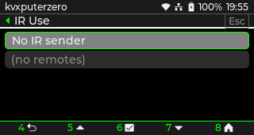
- Current type: Menu/ResultList chrome for empty state
- Target type: Info card
- QoL:
  - [high] “No IR sender” / “(no remotes)” look selectable — **[status: Fixed]** `after/after_ir_use.png`
  - Fix: InfoScreen or Doc empty-state, not Options/Result rows

### usb

#### UseStock placeholder
- Screenshot: 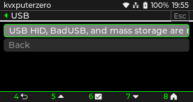
- Current type: Menu (placeholder string as first OptionsList entry)
- Target type: Document / Info card
- Source: `screen_manager.cpp` Placeholder page pushes `ch.placeholder` as a `MenuEntry`
- QoL:
  - [high] Long prose truncated mid-word in a selected pill (“…are r”) — **[status: Fixed]** `after/after_usb_usestock.png`
  - [med] Fake action beside real “Back” — **[status: Fixed]**
  - Fix: DocScreen/InfoScreen for UseStock/ComingSoon; keep only Back as menu

### gps

#### Live Wardrive chooser
- Screenshot: 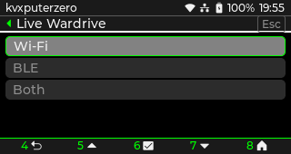
- Current type: Menu — OK (Wi-Fi / BLE / Both are actions)

### rfid / nfc

#### Module Status
- Screenshots: 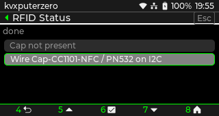 
- Current type: RunScreen pills
- Target type: Info card
- QoL:
  - [high] “Cap not present” + wiring hint are selectable; focus on second line
  - Fix: InfoScreen fields

#### Read (missing hw)
- Screenshot: 
- Current type: RunScreen pill
- Target type: Live log / Info card
- QoL:
  - [high] Same pattern as other cap tools

### files / scripts

#### Browse
- Screenshot: 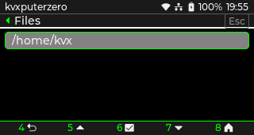
- Current type: Menu — OK if path entries are navigable
- QoL:
  - [low] Single root row is fine as a menu entry

#### File Share hint / run
- Screenshot: 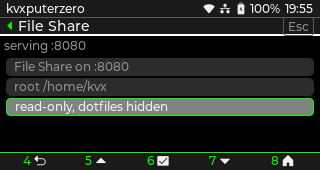
- Current type: RunScreen pills for status lines
- Target type: Info card
- QoL:
  - [high] “File Share on :8080” / root / flags look like menu items
  - Fix: InfoScreen KV + status chip

#### Scripts runner
- Screenshot: 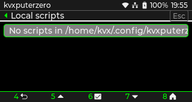
- Current type: Menu — OK

### modules

#### Cap Probe
- Screenshot: 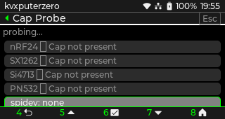
- Current type: RunScreen log pills
- Target type: Info card
- Source: `make_cap_probe` (tree → InfoScreen)
- QoL:
  - [high] Every cap line is a selectable row; focus on `spidev: none` — **[status: Fixed]** `after/after_cap_probe.png`
  - [med] Missing glyph after names (likely `—` / UTF-8) — **[status: Fixed]** (KV text; no missing glyph observed)
  - Fix: InfoScreen KV; status chip “none found”

#### Unit Scroll
- Screenshot: 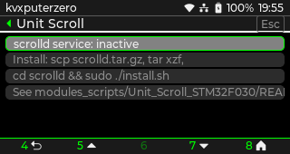
- Current type: ResultList prose
- Target type: Info card (+ short Doc for install)
- Source: `make_unit_scroll` (tree → InfoScreen fields)
- QoL:
  - [high] Install instructions as selectable rows — **[status: Fixed]** `after/after_unit_scroll.png`
  - [med] Docs path clipped — **[status: Fixed]** shortened values + fixed-height DOT rows
  - Fix: InfoScreen + optional Doc link row that is a real action

#### Bus Scanner
- Screenshot: 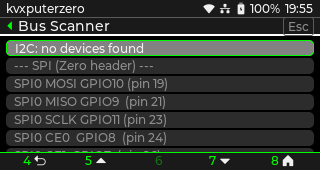
- Current type: ResultList
- Target type: Info card / Document
- Source: `make_results(..., "Bus Scanner", ...)`
- QoL:
  - [high] Pinout dump as menu rows — **[status: Fixed]** `after/after_bus_scan.png`
  - Fix: DocScreen or InfoScreen sections

### others / Tools leftovers

#### SSH hint
- Screenshot: 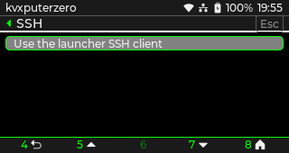
- Current type: ResultList (`make_info`)
- Target type: Document
- Source: `ToolId::SshHint` → `make_info`
- QoL:
  - [high] One-line hint with full selection chrome — **[status: Fixed]** `after/after_ssh_hint.png`
  - Fix: DocScreen

#### iButton
- Screenshot: 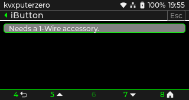
- Current type: ResultList
- Target type: Document / Info card
- QoL:
  - [high] “Needs a 1-Wire accessory.” selectable pill — **[status: Fixed]** `after/after_ibutton.png`

#### MQTT
- Screenshot: 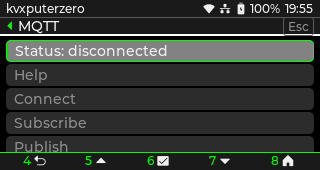
- Current type: Menu with status embedded as first row
- Target type: Menu + separate Info strip
- QoL:
  - [high] “Status: disconnected” is a focusable menu row next to Connect/Subscribe — **[status: Fixed]** `after/after_mqtt_menu.png`; Help → Doc `after/after_mqtt_help.png`
  - Fix: status chip above OptionsList; Help → DocScreen

#### WireGuard
- Screenshot: 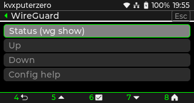
- Current type: Menu — OK
- QoL:
  - [med] “Config help” opens ResultList prose (`make_results` WireGuard help) — target Document — **[status: Fixed]** `after/after_wireguard_help_attempt.png`

### clock / charge / config / tools

#### Clock face
- Screenshot evidence: 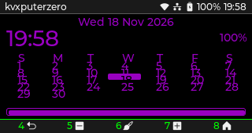 (captured calendar/clock chrome; see also overlapping dates)
- Current type: Clock/PDA face
- QoL:
  - [high] Calendar day numbers overlap vertically — illegible — **[status: Fixed]** `after/after_cal2_charge.png`
  - [med] Today uses a purple pill; OK if days are navigable, confusing if static
  - Fix: fix row metrics in `clock_face_screen` / PDA calendar layout

#### Charge / Config / Tools menus
- Home page 3 selection is correct: 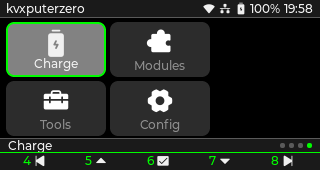
- Deep face/menu captures under those filenames were unreliable across overwrite runs; Config/Tools are OptionsList-style when opened — affordance OK for true menus
- QoL:
  - [low] Confirm ChargeFill face vs ClockFill don’t share broken calendar metrics

## Cross-app consistency

- **Accent border** (`apply_row_state`) = focus for menus **and** for ResultList/RunScreen — users cannot tell action from prose.
- **Titles / Esc:** Consistent header + Esc hint on tool pages.
- **Nav slots 4–8:** Always shown; Documents use Up/Down for scroll; RunScreen slot 6 Check cleared (Enter still pins/freezes).
- **Color:** Green accent + purple main (clock) coexist; fine if role-separated (focus vs brand).
- **Spacing:** ResultList 16–18px row height wastes vertical space vs wrapped Doc body on 170px height.
- **Empty/missing hardware:** Emulator correctly has no caps — but empty states should be Info cards, not fake menus.

## Proposed style rules

1. **Pill + accent border = Menu only.** Never apply `make_list_row` / `apply_row_state` to prose, KV status, or log lines.
2. **Document** = one scrollable wrapped label (`make_doc_body`) inside `make_panel`; Up/Down/,/. scroll; no per-line focus.
3. **Info card** = status chip (`make_status_pill` with semantic color) + non-focusable `make_kv_row` list; R refreshes if probing.
4. **Live log** = plain lines (or subtle alternating rows) with optional follow indicator; Esc/4 cancel or back; do not steal “selection” semantics.
5. **UseStock / ComingSoon** = Document body + single Back action — not a truncated MenuEntry string.
6. **Don’t put status strings inside OptionsList** (MQTT “Status: …”); put them in the header strip.
7. **No hand-wrapping** into vector lines for manuals — wrap at render time.
8. **Light theme** either works end-to-end or remove the control; pinned `dark_mode_` makes Config/theme scripts lie.
9. **Migrate remaining `make_results` call sites** (WireGuard help, BLE disconnect, Morse table?, MQTT help, UART LLM, bus scan, file previews, loot dumps, eth link, AP detail, script/file viewers) to Doc or Info by content shape.
10. **Fix RunScreen chrome** once — every listen/scan/export inherits the fix.

## Prioritized fix list (top 10)

Statuses below are from **Re-verification (after migration)**.

1. **Stop ResultList for manuals** — PC Connect howto/needs (+ WireGuard/MQTT help): DocScreen. — **Fixed**
2. **Stop RunScreen pills for cap status** — RF/NRF24/FM/LoRa/RFID/NFC status → InfoScreen (source started; rebuild & verify). — **Fixed**
3. **Fix RunScreen log chrome** — rf_listen, ble_scan, export, spectrum: non-selectable lines. — **Fixed** (left-rule cursor; Check slot empty)
4. **UseStock placeholder** — USB message as Document, not truncated menu row (`screen_manager.cpp` Placeholder). — **Fixed**
5. **Hints** — ssh_hint, ibutton, nrf24_info, fm_info → DocScreen via `make_info` (verify after DocScreen compile fix). — **Fixed**
6. **Cap Probe / Unit Scroll / Bus Scanner / AP info** — InfoScreen KV (source started). — **Fixed**
7. **MQTT status row** — pull status out of OptionsList. — **Fixed**
8. **IR / BLE disconnect empty states** — Info card, not fake menus. — **Fixed**
9. **Clock calendar overlap** — layout bug on Clock/PDA face. — **Fixed**
10. **Un-pin or implement light theme** — or drop `theme light` automation claims. — **Fixed**

## Everyday apps audit

Focused pass on Calculator, Clock/Charge, Files, Media, Infrared, Config, Wi‑Fi everyday rows, and PDA (plus Passgen). Tooling: `page <name>` in `KVX_UI_SCRIPT` (AppPage opens), scripts `apps_everyday.uiscript` / `apps_pda_deep.uiscript`, shots under `app/screenshot/audit/apps/`.

### Content-type map (apps)

| Screen | Current → Target | Shot |
|--------|------------------|------|
| Tools / Config / Power / Dim / Sound / Wi‑Fi Connect·Disconnect / Media roots / IR Learn·Browse / Files roots | Menu — OK | `apps_tools_menu`, `apps_config_menu`, `apps_power`, `apps_wifi_*`, `apps_media_player`, `apps_ir_learn`, `apps_files_browser` |
| About | Menu pills → **Info card** | `apps_about` → fixed `apps_about_fixed` |
| IR Use / Favorites missing | Info — OK | `apps_ir_use` |
| File Share live | Live log — OK (restyled) | `apps_files_share` |
| Calculator | Work/input (not menu) | `apps_calculator` |
| Clock digital / Charge face | Face — OK | `apps_clock_digital`, `apps_charge_face` |
| PDA hub | Menu grid — OK | `apps_pda_hub` |
| PDA lists / calendar | Menu / calendar — OK | `apps2_*` |
| World clock city list | Selectable list + hint | `apps2_world_clock` |
| Passgen | Custom work screen — OK | `apps2_passgen` |
| File text preview | ResultList → **Document** | source fix in `make_files_browser` |

### Findings (apps)

1. **[high] About as OptionsList** — version / battery / IPv4 were focusable pills + a Back row. **Fix:** `AppPage::About` → `InfoScreen` KV. Status: Fixed after rebuild.
2. **[high] Calculator DEG overlaps Esc** — mode label shared the Esc chip corner (`apps_calculator.png`). **Fix:** align DEG/RAD at `TOP_RIGHT -40`. Status: Fixed.
3. **[med] Calculator function hint clipped by input** — hint at y=90 collided with textarea. **Fix:** shorter history box, hint at y=78, DOT long-mode. Status: Fixed.
4. **[high] WorldClock footer over last city** — hint `OK set TZ…` painted on Sao Paulo row (`apps2_world_clock.png`). **Fix:** `max_rows` 5→4, longer city names + DOT. Status: Fixed.
5. **[med] Notes empty glyph** — em dash rendered as `▯` (`apps2_notes_list.png`). **Fix:** ASCII `-`. Status: Fixed.
6. **[med] File preview as ResultList** — text previews used menu rows. **Fix:** `make_info` → DocScreen. Status: Fixed.
7. **[low] Files default is root picker** — single `/home/kvx` row looks empty until Enter (`apps_files_browser.png`). Acceptable Menu; optional auto-enter sole root later.
8. **[low] Passgen slot 8 empty** — intentional for typing keys; OK.
9. **[low] Brightness list clips last % under footer** — same OptionsList density as elsewhere.
10. **[med] Calculator `type` script** — desktop inject of `sin(90)` mangled under Zero keymap (`:]/(90)`); not a product bug. Prefer `open calculator` + manual keys on device.

### Apps prioritized fix list

1. About → InfoScreen — **Fixed**
2. Calculator DEG vs Esc — **Fixed**
3. WorldClock hint overlap — **Fixed**
4. Notes empty glyph — **Fixed**
5. File preview → Doc — **Fixed**
6. (open) Files sole-root auto-browse — Still open / low
7. (open) Brightness/Config footer clip — Still open / low

## Audit artifacts

- Scripts: `app/scripts/ui_audit/*.uiscript` (incl. `verify_after.uiscript`, `apps_everyday.uiscript`, `apps_pda_deep.uiscript`)
- Screenshots before: `app/screenshot/audit/*.png`
- Screenshots after: `app/screenshot/audit/after/after_*.png`
- Everyday apps shots: `app/screenshot/audit/apps/`
- Runner: `app/scripts/ui_sweep.sh`
- UI script extras: `page <name>` for AppPages (calculator, clock, charge, config, about, pda_*, …)
